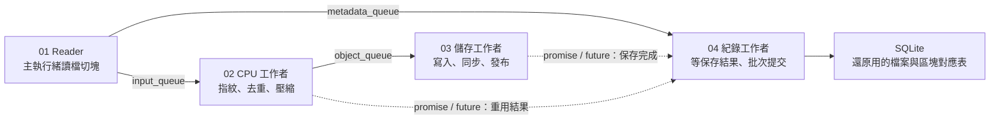

# ParaVault

以 C++20 開發的多執行緒備份引擎，支援內容去重、壓縮、快照還原與自適應排程。

ParaVault is a local snapshot backup engine written in C++20 for macOS and Linux. It stores immutable BLAKE3-addressed 1 MiB chunks, compresses new objects with Zstandard, deduplicates shared content, and publishes snapshots through a SQLite catalog. The engine includes bounded producer/consumer queues, a pipeline memory budget, source-change checks, safe restore paths, full-object verification, fault-injection checkpoints, JSON Lines diagnostics, and an opt-in adaptive CPU admission controller.

The implementation is a portfolio baseline: it must not be treated as the sole copy of important data before you validate it on your own storage, restore scenarios, and failure environment. It does not replace Time Machine.

## Build

Requirements: C++20 compiler, CMake 3.20+, SQLite 3, Zstandard, and POSIX file APIs. Python 3 is used by tests and benchmark tooling.

macOS:

```sh
brew install cmake ninja sqlite zstd
cmake -S . -B build -G Ninja -DCMAKE_BUILD_TYPE=Release
cmake --build build
ctest --test-dir build --output-on-failure
```

Ubuntu / Debian:

```sh
sudo apt-get install cmake ninja-build libsqlite3-dev libzstd-dev
cmake -S . -B build -G Ninja -DCMAKE_BUILD_TYPE=Release
cmake --build build
ctest --test-dir build --output-on-failure
```

The project contains a compact unkeyed BLAKE3-256 implementation based on the public BLAKE3 specification, so the build does not fetch dependencies over the network. SQLite and Zstandard are linked from the system packages.

## 架構概覽

備份時，主執行緒持續讀檔切塊，CPU 與儲存工作者在背景處理已送出的區塊。Reader 另外送出檔案與區塊對應資訊，紀錄工作者等保存結果就緒後才提交資料庫。



不同階段可同時處理不同區塊。01 Reader 在 framework 中登記為 Source，02～04 登記為 Worker stages，Monitor 則是 Observer；所有設定集中在 `configure_stages()`。主流程透過 `pipeline.run()` 完成啟動、來源執行與收尾，成功後才將快照發布為 `COMPLETE`。完整的[啟動、收尾與資料交接流程圖](docs/ARCHITECTURE.md)也標出對應的程式碼入口。

## Source layout

```text
include/pbe/       Public engine API, BLAKE3 API, and bounded queue
src/
├── cli/           Command-line entry point and arguments
├── core/          Backup coordination, snapshot lifecycle, and query operations
├── storage/       SQLite catalog, repository, objects, and packs
├── concurrency/   Memory credits, deduplication claims, and worker pool
├── scheduler/     Worker admission, adaptive CPU scheduling, and I/O policy limits
├── diagnostics/   Bottleneck classification and trace serialization
├── hashing/       BLAKE3 implementation
├── pipeline/      00 framework; 01 reader → 02 CPU → 03 storage; 04 metadata branch
├── restore/       Snapshot restoration
└── benchmark/     Benchmark orchestration and reports
```

Start with `src/cli/main.cpp`, then read the short backup workflow in [`src/core/backup_coordinator.cpp`](src/core/backup_coordinator.cpp). The reusable runtime is under `src/pipeline/00_framework`; numbered directories `01_reader` through `04_metadata` follow data flow and reading order. Backup-specific wiring stays in `src/pipeline/backup_pipeline.cpp`. The full file map and a reading route are in [ARCHITECTURE.md](docs/ARCHITECTURE.md).

## Quick start

The primary command is `paravault`. The original `pbe` command, `include/pbe` API, and `--pbe` tooling options remain available for existing scripts and repositories.

```sh
build/paravault init --repo ~/ParaVaultRepo
build/paravault backup --repo ~/ParaVaultRepo --source ~/Projects --workers 4
build/paravault list --repo ~/ParaVaultRepo
build/paravault verify --repo ~/ParaVaultRepo --snapshot <snapshot-id> --full
build/paravault restore --repo ~/ParaVaultRepo --snapshot <snapshot-id> --target ~/RestoreTest
build/paravault stats --repo ~/ParaVaultRepo --json
```

I/O scheduling is selectable without changing the repository format. The default `streaming` policy overlaps source reads and downstream work. The experimental `phased` policy reads a bounded batch, dispatches it, then waits for every durable object acknowledgement before reading the next batch:

```sh
build/paravault backup --repo ~/ParaVaultRepo --source ~/Projects --io-strategy phased --memory-mib 256
build/paravault backup --repo ~/ParaVaultRepo --source ~/Projects --io-strategy phased --memory-mib 256 --io-batch-mib 32
```

`--io-batch-mib` caps raw batch size for `phased`; 0 selects capacity automatically. Complete raw/compression credits still cap the actual batch, reported as `I/O Batch Chunks`. For example, 256 MiB of credits currently permits 127 full chunks. The credit limit does not cap total process RSS. Phasing changes overlap, pack sizes and sync frequency, so it is not assumed faster. See the [policy design](docs/PIPELINE.md#reader-的兩種-io-排程) and [comparison workflow](docs/BENCHMARK.md).

Adaptive scheduling and explicit trusted-metadata reuse are opt-in:

```sh
build/paravault backup --repo ~/ParaVaultRepo --source ~/Projects --scheduler adaptive --max-workers 8 --memory-mib 256
build/paravault backup --repo ~/ParaVaultRepo --source ~/Projects --trust-metadata
build/paravault explain --repo ~/ParaVaultRepo --run <run-id>
```

The default `files-v1` repository stores each unique chunk as a separate file. To experiment with batched immutable pack storage, select it when creating a new repository:

```sh
build/paravault init --repo ~/ParaVaultRepo-Packs --storage-format pack-v2
build/paravault backup --repo ~/ParaVaultRepo-Packs --source ~/Projects --workers 4 --writer-workers 1 --memory-mib 256
```

`pack-v2` streams compressed chunks into temporary packs, gathering up to eight already-available objects into a `writev()` call without an extra payload buffer. Chunk buffers and credits are released after staging, while durable acknowledgements wait for pack fsync, publication, and directory sync. The writer targets 128 MiB or 256 objects and flushes after 2 ms idle; the target is not a guaranteed size. `files-v1` remains the default. Pack-v2 requires a new repository and cannot be enabled by editing an existing repository's configuration; older engine binaries do not understand it.

On macOS, object and pack publication first use hard links. If the destination filesystem rejects hard links, the engine tries `renamex_np(RENAME_EXCL)` to publish the completed staging file without replacing an existing destination. This supports the tested external FAT32 volume without changing the repository format or copying payloads a second time. Filesystems that support neither operation fail explicitly; the engine never falls back to a rename that can overwrite existing data. This does not establish power-loss durability for removable media.

Catalog query connections enforce SQLite `query_only=ON`. On the tested macOS FAT32 filesystem, they use a read/write file handle to permit SQLite WAL maintenance; native read-only handles produced `SQLITE_IOERR_WRITE` after an interrupted backup. Other filesystems retain native read-only query handles. Queries cannot change application metadata, but FAT32 verification may update SQLite's maintenance files. Recovery ignores macOS AppleDouble `._` sidecars when identifying orphan packs.

Backup runs the reader, CPU workers, storage writers, and a dedicated metadata consumer concurrently. The reader continues across file boundaries; CPU workers submit asynchronous writes or duplicate continuations and continue with new chunks. Metadata transactions span files and begin only after durable results arrive. See the [pipeline design](docs/PIPELINE.md), current pipeline scaling measurements (local report; not included), and earlier storage-format experiment (local report; not included).

On the local machine with eight logical CPUs, a generated 10.016 GiB project with 4,021 files improved from a backup median of 34.588 seconds to 11.106 seconds at the same four CPU workers and two storage writers (3.11×). A generated 10 GiB compressible log fixture scaled from 12.601 seconds with one CPU worker to 3.525 seconds with eight (3.57×), using one storage writer. The random-asset fixture scaled only about 1.20× because its writes dominated. Every trial used a fresh repository and passed full verification; the linked report preserves all runs and their limits.

`--trust-metadata` reuses a previous file's chunk map when its relative path, size, mode, and modification time match. Reused objects are fully checked; a bounded 4,096-ID recent cache avoids repeating checks for recently seen objects, and evicted IDs may be checked again on very high-cardinality backups. The option trusts source metadata and can miss a same-size source change with a restored timestamp. Use the default full-read behavior or `--paranoid` when that tradeoff is unacceptable. Restore requires a new or empty target and does not overwrite paths. Symlinks are stored as links and never followed during source scan or restore. Basic mode and mtime are saved; ACLs, xattrs, ownership, resource forks, Finder metadata, and hardlink relationships are outside this version's fidelity promise.

## Commands

- `init --repo PATH [--storage-format files-v1|pack-v2]`: initialize an empty repository; existing non-empty directories are refused. `files-v1` is the default.
- `backup --repo PATH --source PATH`: create and publish a snapshot. Configure CPU `--workers`, object-persistence `--writer-workers` (1 by default; maximum 32), `--memory-mib`, `--zstd-level`, `--scheduler fixed|adaptive`, `--max-workers`, `--skip-unsupported`, `--paranoid`, or `--trust-metadata`.
- `list`, `show`, `restore`, and `verify`: inspect, reconstruct, or fully check complete snapshots.
- `stats --json`: report logical bytes, object files, referenced objects, and physical object bytes.
- `explain --repo PATH --run RUN_ID [--json]`: summarize a decision trace and follow-up experiments as text or JSON.
- `benchmark --dataset PATH`: compare profiles using fresh temporary repositories; accepts `--storage-format files-v1|pack-v2` and writes JSON, CSV, and Markdown.
- `python3 tools/benchmark_storage_formats.py`: generate a 10 GiB random fixture, compare both formats with full verification, and save JSONL traces plus Markdown/JSON results. Temporary fixture and repositories are removed automatically.

For controlled diagnostic runs, `benchmark` also accepts `--test-writer-delay-ms N`, `--test-reader-delay-ms N`, and `--test-cpu-spin-ms N`. They inject writer/input delays or CPU work and do not simulate a particular disk or processor.

Reproduce the four controlled CPU, writer, memory, and input scenarios and preserve their JSONL traces with `python3 tools/run_diagnostic_scenarios.py --pbe build-release/paravault --output reports/diagnostics`; see [the diagnostics guide](docs/DIAGNOSTICS_SCHEMA.md).

## Local monitoring dashboard

Start the local UI after building ParaVault:

```sh
python3 tools/paravault_dashboard.py --engine build-release/paravault
```

Open `http://127.0.0.1:8765` to initialize or select a repository, choose its storage format when creating it, start a backup, choose the number of object writers, watch live throughput and pipeline diagnostics, and review recent snapshots. The dashboard binds to localhost and uses only Python's standard library. See the [dashboard guide](docs/DASHBOARD.md).

The `--failpoint NAME` option is for disposable test repositories only. It abruptly exits with status 86 at a named checkpoint and models process termination, not power loss. Supported names are listed in [docs/FAILURE_MODEL.md](docs/FAILURE_MODEL.md).

## Benchmark fixtures

Create deterministic A-F dataset profiles and run the fixed/adaptive comparison suite:

```sh
python3 tools/generate_dataset.py --output fixtures --profiles A,B,C,D,E,F --size-mib 32
python3 tools/run_benchmark.py --pbe build/paravault --fixtures fixtures --output reports/benchmark --repeat 5
```

Read [docs/BENCHMARK.md](docs/BENCHMARK.md) before comparing results. ParaVault reports local observations; it does not claim a guaranteed speedup or a physical disk bottleneck.

## Current implementation and validation

The repository implements the P0 backup, deduplication, compression, snapshot, restore, and verify paths, plus opt-in trusted-metadata reuse, symlink metadata, metrics traces, explain output, fault injection, a conservative adaptive CPU gate, and fresh-repository benchmark tooling. The code responsibility map is in [ARCHITECTURE.md](docs/ARCHITECTURE.md). The CMake test suite covers chunk/hash/codec boundaries, Unicode paths, queue and process cancellation, worker counts 1/2/4/8, metadata preservation, corrupted objects, CLI flows, recovery after crashes, and the five process-crash checkpoints. See the detailed [test matrix](docs/TESTING.md). Generated benchmark reports, fixtures, and backup repositories are kept locally and are not distributed with the source. Reproduce measurements on the target machine using the benchmark tools above. Linux CI, sanitizer support beyond UBSan, and platform-specific power-loss validation still need confirmation in their target environments.

Detailed design notes are in [docs/ARCHITECTURE.md](docs/ARCHITECTURE.md), [docs/FORMAT.md](docs/FORMAT.md), [docs/FAILURE_MODEL.md](docs/FAILURE_MODEL.md), [docs/SCHEDULER_ADR.md](docs/SCHEDULER_ADR.md), and [docs/DIAGNOSTICS_SCHEMA.md](docs/DIAGNOSTICS_SCHEMA.md).

## License

ParaVault is distributed under the [MIT License](LICENSE). Dependency licenses and algorithm references are documented in [THIRD_PARTY_NOTICES.md](THIRD_PARTY_NOTICES.md).
