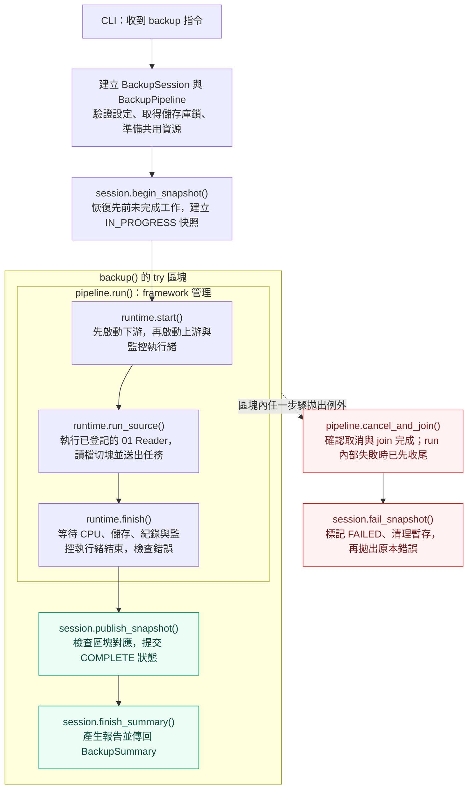
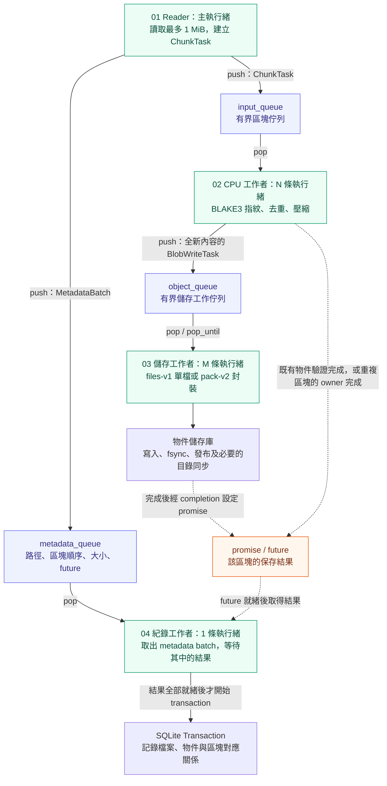

# Architecture

ParaVault scans the source tree and then runs a reader, a fixed set of CPU workers, an object-writer pool, and a dedicated metadata consumer concurrently. The reader continues across file boundaries without waiting for chunk acknowledgements. CPU workers calculate BLAKE3, claim a digest, and compress new content. They submit asynchronous object writes or subscribe to an existing claim and continue with the next chunk. Storage workers publish immutable loose objects or streaming packs. The metadata consumer resolves their durable acknowledgements before committing entries and references in batches spanning multiple files.

## 備份的主流程

先看 `src/core/backup_coordinator.cpp` 的 `pipeline.run()`。Reader 與其餘階段都先在 `configure_stages()` 登記，再由 framework 統一執行生命週期：啟動背景工作者、在呼叫者執行緒執行 Reader、等待下游工作完成。



`BackupPipeline` 先登記 Source `01_reader`、Worker stages `02_cpu`／`03_storage`／`04_metadata`，以及旁路 Observer monitor。`00_framework/PipelineRuntime` 先反向啟動下游工作者，再執行已登記的 Source。資料夾編號表示資料流與閱讀順序；實際執行時間由作業系統排程。Reader 使用呼叫者執行緒，下游同時在背景處理。`run()` 成功返回前會等所有工作完成，失敗時則先取消並 join；快照發布仍由 session 負責。

## 區塊如何在執行緒之間交接

下圖的實線表示透過佇列交接工作或保存資料，虛線表示區塊結果的通知。不同階段可以同時處理不同區塊；同一區塊仍依照資料依賴前進。



例如 Reader 的 `input_queue.push()` 和 CPU 工作者的 `input_queue.pop()` 操作同一個佇列。CPU 的 `object_queue.push()` 則與儲存工作者的 `object_queue.pop()` 接起來。Reader 另外送出還原用的對應資訊；紀錄工作者先等待保存結果，再提交資料庫。

N 是建立的 CPU 工作者數，M 是 `writer_workers`。監控執行緒另外讀取各階段的計數器與佇列狀態；啟用自適應排程時，透過 `ActiveWorkerGate` 調整同時計算的額度。佇列滿或記憶體額度不足時，上游會等待下游前進。

| 圖中的步驟 | 程式碼入口 |
|---|---|
| 主流程 | [`backup()`](../src/core/backup_coordinator.cpp) |
| 角色設定與完整執行 | [`BackupPipeline::configure_stages()` / `run()`](../src/pipeline/backup_pipeline.cpp) |
| 通用啟動、來源執行與收尾 | [`PipelineRuntime::run()`](../src/pipeline/00_framework/pipeline_runtime.cpp) |
| 讀檔、送出區塊與 metadata | [`read_source_files()` / `read_file()`](../src/pipeline/01_reader/reader_stage.cpp) |
| 決定立即交接或分批等 ACK | [`SourceIoScheduler`](../src/pipeline/01_reader/source_io_scheduler.cpp)，設定與容量由 [`IoPolicy`](../src/scheduler/io_policy.cpp) 驗證 |
| 處理區塊、提交儲存工作 | [`process_chunk()` / `submit_new_object()`](../src/pipeline/02_cpu/cpu_stage.cpp) |
| 保存資料與通知完成 | [`run_loose_object_writer()`](../src/pipeline/03_storage/loose_writer.cpp)、[`run_pack_object_writer()`](../src/pipeline/03_storage/pack_writer.cpp) |
| 等結果、提交還原對應表 | [`run_metadata_writer()`](../src/pipeline/04_metadata/metadata_writer.cpp)、[`commit_metadata_batch()`](../src/pipeline/04_metadata/metadata_commit.cpp) |

## 資源限制與一致性

All three queues are bounded. A credit is reserved before a raw chunk is allocated. Files-v1 holds it through object publication; pack-v2 releases it after a gathered staging write has finished and its buffer has been freed. Duplicate tasks release raw buffers and credits before subscribing to the owner's result. Each credit covers a full 1 MiB raw chunk and `ZSTD_compressBound(1 MiB)`. Pack writers gather up to eight already-available chunks into `writev()` without another payload buffer. The budget bounds pipeline buffers, not whole-process RSS. Metadata has a separate bound: four queued batches, one consumer batch, and one reader batch, each with at most 128 entries and the configured chunk limit.

SQLite is the metadata authority. `IN_PROGRESS` rows are never listed or restored. Blob objects are durable before a reference is committed. The final `COMPLETE` update is a separate full-synchronous SQLite transaction. A crash can leave orphan objects or an incomplete snapshot, but the previous complete snapshots remain readable.

The adaptive controller samples every two seconds. It holds during two warmup windows, waits two cooldown windows after a decision, and changes the CPU admission limit by one. It does not create or destroy threads, change chunking, change object publishing, or modify SQLite commits. It can roll back a limit after two comparable windows show a large throughput regression; this is a heuristic observation, not a causal guarantee.

ParaVault uses `std::thread` with an explicit close, cancel, and join protocol because the Apple Clang/libc++ supplied in the development environment does not expose `std::jthread`. The queues and credits use mutexes, condition variables, timed cancellation checks, and RAII ownership.

## Implementation boundaries

Source files are grouped by responsibility. Public interfaces live under `include/pbe`; implementation headers live beside their module's source files.

```text
include/pbe/
├── blake3.hpp
├── bounded_queue.hpp
└── engine.hpp
src/
├── benchmark/
│   └── benchmark_runner.cpp
├── cli/
│   └── main.cpp
├── concurrency/
│   ├── claim_registry.hpp
│   ├── memory_budget.hpp
│   ├── worker_error.hpp
│   └── worker_pool.hpp
├── core/
│   ├── backup_coordinator.cpp
│   ├── backup_session.hpp / .cpp
│   └── engine.cpp
├── diagnostics/
│   ├── diagnostics.cpp
│   ├── diagnostics.hpp
│   ├── pipeline_metrics.hpp / .cpp
│   └── pipeline_monitor.cpp
├── hashing/
│   └── blake3.cpp
├── pipeline/
│   ├── 00_framework/
│   │   └── pipeline_runtime.hpp / .cpp
│   ├── 01_reader/
│   │   ├── reader_stage.hpp / .cpp
│   │   ├── source_scanner.hpp / .cpp
│   │   ├── source_file.hpp / .cpp
│   │   ├── source_io_scheduler.hpp / .cpp
│   │   ├── cached_file_reader.hpp / .cpp
│   │   └── metadata_batcher.hpp / .cpp
│   ├── 02_cpu/
│   │   ├── cpu_stage.hpp / .cpp
│   │   ├── chunk_codec.hpp / .cpp
│   │   ├── object_reuse.hpp / .cpp
│   │   └── chunk_completion.hpp / .cpp
│   ├── 03_storage/
│   │   ├── storage_stage.hpp
│   │   ├── loose_writer.cpp
│   │   ├── pack_writer.cpp
│   │   └── writer_completion.hpp
│   ├── 04_metadata/
│   │   ├── metadata_writer.hpp / .cpp
│   │   └── metadata_commit.hpp / .cpp
│   ├── shared/
│   │   ├── messages.hpp
│   │   ├── pipeline_context.hpp / .cpp
│   │   └── stage_support.hpp / .cpp
│   └── backup_pipeline.hpp / .cpp
├── restore/
│   └── restore_engine.cpp
├── scheduler/
│   ├── active_worker_gate.hpp
│   ├── adaptive_controller.cpp
│   ├── adaptive_controller.hpp
│   └── io_policy.hpp / .cpp
└── storage/
    ├── catalog.cpp
    ├── catalog.hpp
    ├── object_store.cpp
    ├── object_store.hpp
    ├── repository.cpp
    ├── repository.hpp
    ├── snapshot_catalog.cpp
    └── snapshot_catalog.hpp
```

| Module / file | Responsibility |
|---|---|
| `include/pbe/engine.hpp` | Public command options, summaries, and engine entry points |
| `src/cli/main.cpp` | CLI argument validation and command dispatch |
| `src/core/backup_coordinator.cpp` | Public backup entry point: start, read, join, publish; cancel and mark failure on exceptions |
| `src/core/backup_session.hpp` / `.cpp` | Validate options, own repository lock/catalog, recover prior work, begin/publish/fail snapshots, and write summary reports |
| `src/core/engine.cpp` | Repository initialization, snapshot queries, verification, statistics, and explanation output |
| `src/pipeline/00_framework/pipeline_runtime.hpp` / `.cpp` | Reusable stage registration, downstream-first startup, caller-side source execution, ordered draining, first-error propagation, cancellation and RAII joining; no backup, SQLite or compression dependency |
| `src/pipeline/backup_pipeline.hpp` / `.cpp` | Backup-specific wiring: register the CPU, storage and metadata stages, the reader callback, queue closers, CPU preparation and monitor |
| `src/pipeline/shared/messages.hpp` | Typed chunk tasks and metadata batches passed between stages |
| `src/pipeline/shared/pipeline_context.hpp` / `.cpp` | Shared bounded queues, credits, claims, metrics, and references to the longer-lived session |
| `src/pipeline/01_reader/` | Reader orchestration, source scanning, RAII file reads/change checks, trusted cached reads and metadata batching, each behind its own interface |
| `src/pipeline/02_cpu/` | Worker orchestration plus separate codec, object reuse and asynchronous completion components |
| `src/pipeline/03_storage/` | Separate files-v1 and pack-v2 writers; PackSegment separates collecting, staging, publishing and completion |
| `src/pipeline/04_metadata/metadata_writer.cpp` | Consume metadata batches, aggregate committed results, and release completed claims |
| `src/pipeline/shared/stage_support.hpp` / `.cpp` | Shared stage timing and cancellable diagnostic test work |
| `src/concurrency/worker_error.hpp` | Preserve the first failure and signal cancellation across stages |
| `src/diagnostics/pipeline_metrics.hpp` / `.cpp` | Atomic stage counters, read/write timing accounting, and RSS sampling |
| `src/diagnostics/pipeline_monitor.cpp` | Sample counters/queues, construct observation windows, apply controller decisions, and serialize traces |
| `src/storage/catalog.hpp` / `.cpp` | SQLite statements, transactions, repository connection, and schema creation |
| `src/storage/snapshot_catalog.hpp` / `.cpp` | Snapshot entries/chunks, path validation, and chunk-map queries |
| `src/storage/repository.hpp` / `.cpp` | Repository configuration validation, canonical paths, containment checks, and writer lock |
| `src/storage/object_store.hpp` / `.cpp` | Object and pack formats, immutable reads/writes, digest verification, bounded recent verification cache, and directory sync |
| `src/restore/restore_engine.cpp` | Safe path traversal and snapshot restoration |
| `src/concurrency/memory_budget.hpp` | RAII credits for chunk buffers and bounded memory usage |
| `src/concurrency/claim_registry.hpp` | In-flight deduplication ownership, completion, failure, and release after catalog commit |
| `src/pipeline/04_metadata/metadata_commit.hpp` / `.cpp` | Cross-file metadata batches, cancellable ACK waits, prepared statement reuse, and atomic commits |
| `src/concurrency/worker_pool.hpp` | Fixed worker creation and explicit joining |
| `src/scheduler/active_worker_gate.hpp` | CPU worker admission limit, waiting, and cancellation |
| `src/scheduler/adaptive_controller.hpp` / `.cpp` | Stateful admission decisions and best-effort regression rollback policy |
| `src/scheduler/io_policy.hpp` / `.cpp` | Validate I/O policy and derive phased capacity from raw/compression credits |
| `src/pipeline/01_reader/source_io_scheduler.hpp` / `.cpp` | Streaming handoff or bounded phased reads followed by all durable ACKs |
| `src/diagnostics/diagnostics.hpp` / `.cpp` | Window data, bottleneck classification, and versioned trace serialization |
| `src/benchmark/benchmark_runner.cpp` | Fresh-repository benchmark orchestration and JSON/CSV/Markdown reports |
| `src/hashing/blake3.cpp` / `include/pbe/blake3.hpp` | BLAKE3 hashing and digest encoding |
| `include/pbe/bounded_queue.hpp` | Reusable bounded producer/consumer queue |

Internal includes name their module, such as `storage/object_store.hpp` and `scheduler/active_worker_gate.hpp`. Public consumers include `pbe/engine.hpp`. CMake exposes `include` to consumers and keeps the `src` include root private to the engine and its internal tests.

The coordinator sequences a `BackupSession` and a `BackupPipeline`. The session owns the repository lock, snapshot lifecycle, and catalog. BackupPipeline owns the typed context and the generic PipelineRuntime; the runtime holds a registered source, worker stages, and observers. Its `run()` starts consumers, executes the source on the caller thread, drains workers, and stops observers. A failed run cancels and joins before rethrowing the first error. The runtime destructor also cancels and joins unfinished phased execution. BackupPipeline declares the runtime after its context and monitor stop flag, so runtime destruction completes before captured resources are released. The session must outlive the pipeline. During backup, only the metadata consumer changes catalog rows; CPU lookups and trusted-metadata queries use separate connections with SQLite `query_only=ON`. These connections open native read-only handles except on the tested macOS FAT32 filesystem, where a read/write handle permits SQLite WAL maintenance. The consumer resolves all object futures before beginning a transaction, inserts entries before references, and releases dedup claims after commit. Both storage formats acknowledge only after durable publication. See [PIPELINE.md](PIPELINE.md) for the execution and cancellation protocol.

The monitor gathers window samples and applies the controller's returned decision to `ActiveWorkerGate`. The controller policy itself has no access to queues, storage, SQLite, or metrics, which makes warmup, admission changes, cooldown, and regression rollback directly testable.

## 從哪裡開始讀

先讀 `src/core/backup_coordinator.cpp` 的 `backup()`。它只串接生命週期，內部步驟都有具體實作位置：

1. `make_backup_plan()`、`BackupSession::begin_snapshot()`：檢查設定、取得鎖、建立未完成快照。
2. `BackupPipeline::configure_stages()`：集中看 01 Source、02～04 Worker 與 Monitor Observer 的設定；再追 `00_framework/PipelineRuntime::run()` 如何管理啟動、來源、排空與失敗收尾。
3. `01_reader/read_source_files()` → `read_file()`：讀取來源並送出區塊。掃描、檔案 I/O、快取重用及 metadata batching 各有獨立檔案。
4. `02_cpu/run_chunk_worker()` → `process_chunk()`：取工作，依序追到 `hash_chunk()`、`reuse_existing_object()`、`compress_chunk()`、`submit_new_object()`。
5. `03_storage/run_loose_object_writer()` 或 `run_pack_object_writer()`：保存區塊，成功後才通知等待者。
6. `04_metadata/run_metadata_writer()` → `commit_metadata_batch()`：等保存結果、寫入檔案和區塊對應表。
7. `PipelineRuntime::finish()` → `BackupSession::publish_snapshot()`：等所有階段結束，檢查區塊排列後發布 `COMPLETE`。

第一遍沿著 `input_queue` 與 `object_queue` 的 `push` / `pop` 追一個新區塊。第二遍再讀 `PipelineMonitor`、取消流程與錯誤處理。共用的 `PipelineContext` 負責資料生命週期，回呼只保留它的參照及必要的值，不保留階段函式的區域變數參照。
