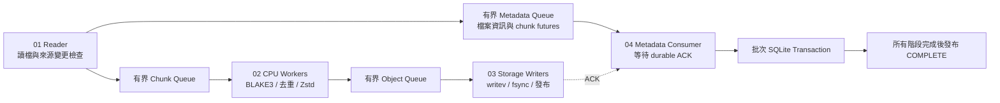
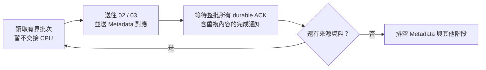

# 備份 Pipeline

這個版本把讀取、CPU 計算、物件寫入與 SQLite 提交分成可以重疊執行的階段。Reader 讀完一個檔案後，會接著讀下一個檔案，已排入工作的 chunk 由後續階段繼續處理。



## 目錄與閱讀順序

```text
src/pipeline/
├── 00_framework/    通用框架：Source / Worker / Observer、執行緒、取消與收尾
├── 01_reader/       讀檔與切塊；另送 metadata 支線
├── 02_cpu/          指紋、去重、壓縮與完成回呼
├── 03_storage/      單檔或 pack 寫入與持久化通知
├── 04_metadata/     等保存結果、提交 SQLite 對應表
├── shared/          跨 stage 的訊息型別與共用資源
└── backup_pipeline.hpp / .cpp  備份的接線與入口
```

01 → 02 → 03 表示區塊的資料流順序。Reader 同時把檔案路徑、區塊順序與 future 送給 04；04 等相應的保存結果完成後才提交。這些階段可以重疊執行，編號也是閱讀順序。

## 00_framework：先建立通用生命週期

[`PipelineRuntime`](../src/pipeline/00_framework/pipeline_runtime.hpp) 是獨立的 `pbe_pipeline_runtime` library，只有執行緒依賴，不包含備份設定、SQLite、Zstd 或儲存格式。它明確區分三種角色；資料內容與 queue 型別由使用者提供。

| 角色 | 在備份中的對應 | 責任 |
|---|---|---|
| `PipelineSource` | 01 Reader | 沒有輸入 queue，產生任務送往下游；在呼叫者執行緒執行 |
| `PipelineStage` | 02 CPU、03 Storage、04 Metadata | 由固定數量的背景 worker 消費輸入；以 `close_input` 通知停止收新任務 |
| `PipelineObserver` | Monitor | 同時觀測各階段，不參與資料交接；工作排空後才停止 |

一般呼叫者在設定完成後執行 `run()`：framework 負責啟動、執行已登記的來源、排空與回收。它成功返回時所有背景工作已結束；若執行失敗，也會先取消並 join，再將第一個錯誤傳回呼叫者。需要分段控制生命週期時，則依序使用 `start()`、`run_source()`、`finish()`。

| 介面 | 合約 |
|---|---|
| `set_source({name, run, request_stop})` | 啟動前登記唯一的來源；`request_stop` 可省略，用於取消時喚醒來源自己的等待資源 |
| `add_stage({name, workers, run, close_input})` | 在啟動前按依賴順序登記工作階段；名稱唯一、工作者數大於零 |
| `add_observer({name, run, request_stop})` | 登記監控等旁路工作，不列入區塊處理順序 |
| `run(prepare)` | 完整執行一次；成功或失敗都在返回前回收已建立的執行緒 |
| `start(prepare)` | 執行準備函式，再從下游往上游建立工作者，最後啟動 observers |
| `run_source()` | 在呼叫者執行緒執行已登記的來源，最多一次；例外會觸發取消 |
| `finish()` | 來源完成後，按登記順序關閉各 stage 的輸入並 join，最後停止並 join observers |
| `cancel_and_join(error)` / 解構 | 關閉所有輸入、通知取消、回收全部已建立的執行緒；保留第一個錯誤 |

啟動前必須有一個 Source 與至少一個 Worker stage；所有角色共用唯一名稱，啟動後不能再改設定。生命週期 API 由同一條呼叫執行緒操作。Worker 的 `run` 可被多個工作者同時呼叫，其共用資料必須同步；`close_input`、`request_stop` 與取消資源回呼需可重複呼叫、可與工作者並行、不拋出例外、不阻塞，並能喚醒等待者。Source 需檢查共用取消旗標、處理下游關閉，或提供停止回呼。回呼捕捉的 queues、取消狀態與其他資源必須活得比 runtime 久。

[`BackupPipeline::configure_stages()`](../src/pipeline/backup_pipeline.cpp) 將 `01_reader`、`02_cpu`、`03_storage`、`04_metadata` 及 monitor 的設定放在一起，使用 `.name`、`.workers`、`.run` 等具名欄位表達用途。框架依序啟動 04 → 03 → 02 → monitor，再執行已登記的 01；正常結束則依序排空 02 → 03 → 04，最後結束 monitor。這保留了 Reader 與下游的重疊並行，並未新增 Reader thread。

`run()` 會阻塞呼叫者直到工作結束；若整合原生 UI，應從背景工作呼叫整個 `backup()`，讓 UI 執行緒持續處理畫面與操作。

停止回呼也可能在準備失敗、Source 尚未開始或已完成時呼叫，因此需能安全處理這些狀態。正常完成不呼叫 Source 的停止回呼；只有取消路徑會通知它。

`BackupPipeline` 持有 context、監控停止旗標與 runtime。runtime 宣告在最後，因此會先解構並回收執行緒，再釋放仍被回呼使用的 context。

## 各 stage 的實作邊界

| Stage | 入口與拆分 |
|---|---|
| 01 Reader | [`reader_stage.cpp`](../src/pipeline/01_reader/reader_stage.cpp) 串接 `source_scanner`、`source_file`、`source_io_scheduler`、`cached_file_reader` 與 `metadata_batcher` |
| 02 CPU | [`cpu_stage.cpp`](../src/pipeline/02_cpu/cpu_stage.cpp) 串接 `chunk_codec`、`object_reuse` 與 `chunk_completion` |
| 03 Storage | [`loose_writer.cpp`](../src/pipeline/03_storage/loose_writer.cpp) 與 [`pack_writer.cpp`](../src/pipeline/03_storage/pack_writer.cpp) 提供兩種格式；`PackSegment` 分開收集、staging、publish 和完成通知 |
| 04 Metadata | [`metadata_writer.cpp`](../src/pipeline/04_metadata/metadata_writer.cpp) 取 batch，交給 [`metadata_commit.cpp`](../src/pipeline/04_metadata/metadata_commit.cpp) 等結果並提交 |

## 各階段如何前進

1. **01 Reader** 掃描來源，在配置 raw buffer 前取得 memory credit。`SourceIoScheduler` 依策略立即交接，或累積有界批次後排入 CPU queue，並把相對路徑、ordinal、大小和 shared future 放進 metadata batch。`SourceFile` 管理檔案描述元與來源變更檢查。
2. **02 CPU** 計算 hashing，先取得 digest 的處理權再查 repository，避免查詢與 claim 釋放交錯時重複寫入。新物件壓縮後非同步交給 writer；重複物件會釋放 raw buffer 和 credit、登記完成回呼，繼續處理下一塊。
3. **03 Storage** 將資料持久化後回傳結果。Pack writer 把最多 8 個已排好的物件用一次 `writev()` 寫入，不會等滿才寫；每組寫完就釋放 payload 與 credit，完成 fsync、無覆寫發布和目錄同步後才回 ACK。
4. **04 Metadata** 先等 batch 中的 ACK，再開啟 SQLite transaction，插入 entries、objects、chunk references。Prepared statements 在 batch 內重用；提交成功後才釋放完成的 claims。

每個 metadata batch 最多 128 個 entry，或到達 chunk batch 上限時送出。Pack-v2 的 chunk 上限為 `256 × writer_workers`；files-v1 為 `max(8, 4 × CPU workers)`。Metadata queue 容量是 4，因此 futures 與尚待提交的 metadata 也有固定上限。

## Reader 的兩種 I/O 排程

策略設定由 [`IoPolicy`](../src/scheduler/io_policy.hpp) 在啟動前驗證，交接行為封裝在 [`SourceIoScheduler`](../src/pipeline/01_reader/source_io_scheduler.hpp)。CPU、Storage、Metadata 的實作與儲存格式共用，預設仍是 `streaming`。

| 策略 | Reader 行為 | 取捨 |
|---|---|---|
| `streaming` | 每讀完一塊就交給 CPU，接著讀下一塊 | 保留來源讀取、計算與物件寫入的重疊 |
| `phased` | 先讀入一批，整批送出後等待所有 durable ACK，再讀下一批 | 降低來源 payload 與 object 寫入的重疊，但可能失去並行效益、增加小 Pack 與同步次數 |



`--memory-mib` 控制完整 chunk 額度，包含 raw 與最壞情況壓縮 buffer；`--io-batch-mib` 另外限制 phased 每批 raw 上限，0 表示自動。實際塊數為兩項容量的較小者。例如 256 MiB 額度自動得到 127 個 1 MiB chunks，3 MiB 額度仍可處理一塊。明確指定過大的 raw 批次也會受額度限制，實際值記錄為 `io_batch_chunks`。

滿批時要先送出並等 ACK，才能申請下一塊額度；若先申請，Reader 可能持有整批資料卻等待自己尚未送出的工作釋放額度。最後不足一批會在 Reader 結束前送出。檔案邊界不強制切批，重用 metadata 快取前會先排空已讀批次。

同一個 `shared_future` 讓 Reader 排程器與 Metadata 都能觀察完成或失敗。等待順序可以不同，但必須所有 chunk 都完成，不能只等最後一塊或 queue 變空。錯誤／取消仍交由既有 runtime 關閉與 join。

phased 排開的是來源 payload 讀取與 object 寫入，SQLite 提交、來源掃描和 OS 背景回寫仍可能並行；普通 `fsync` 的既有持久性範圍不因這個模式而擴大。CPU adaptive admission 與 I/O 策略是不同控制項，可組合使用；目前的 CPU 控制器尚未針對交替讀寫視窗調校，策略效能比較使用 fixed CPU Workers。

## 記憶體、停止與錯誤

每個 chunk 的 credit 涵蓋 1 MiB raw buffer 和 Zstd 壓縮上界。`writev()` 使用原有 buffers，不建立另一份合併 payload。這個額度控制在途 chunk buffer；程式、SQLite、metadata、allocator 和作業系統 page cache 的記憶體另外計算。

正常結束時，Reader 先送出最後的 metadata batch。Framework 關閉 CPU 輸入並等工作者完成，再關閉並等待 storage writers，接著關閉並等待 metadata consumer，最後停止 monitor。經過 chunk layout 檢查後，才以獨立 transaction 將 snapshot 設為 `COMPLETE`。

任一階段發生錯誤時會記住第一個 exception，關閉三個 queues 和 CPU admission gate，讓所有階段停止。Metadata future 的等待每 10 ms 檢查取消，memory credit 等待每 50 ms 檢查取消。所有執行緒 join 後才寫入 `FAILED`。程序突然終止則沿用 staging、未完成 snapshot 與 orphan pack recovery 流程。

## 如何量測

`tools/benchmark_pipeline.py` 對同一份保留的資料測 1／2／4／8 CPU workers，每次使用新的 repository，並完整驗證結果。它記錄 process wall/user/system time、各階段耗時、memory credit 峰值，以及小於 1 KiB 和大於 64 MiB 的 pack 數量。這可分辨「大量小檔各自一包」和「大型資料 pack 沒填滿」兩種情形。

```sh
python3 tools/generate_pipeline_fixture.py --output /private/tmp/pbe-log-fixture --kind logs
python3 tools/benchmark_pipeline.py \
  --pbe build-release/pbe --dataset /private/tmp/pbe-log-fixture/source \
  --label pipeline --output reports/pipeline-logs \
  --workers 1,2,4,8 --writer-workers 1 --repeat 2
```

`logs` 是每個 1 MiB chunk 都有唯一前綴的可壓縮紀錄資料；`random` 則是不可壓縮隨機資料。兩者都使用真實 hashing、壓縮、寫入和驗證，不注入 CPU 空轉或人為等待。應分別看待 CPU 計算與儲存吞吐限制，不能把單一 fixture 的加速比套用到所有資料。

Schema v6 將實際 queue 阻塞與非同步 ACK 延遲分開。詳細欄位見 [DIAGNOSTICS_SCHEMA.md](DIAGNOSTICS_SCHEMA.md)。
